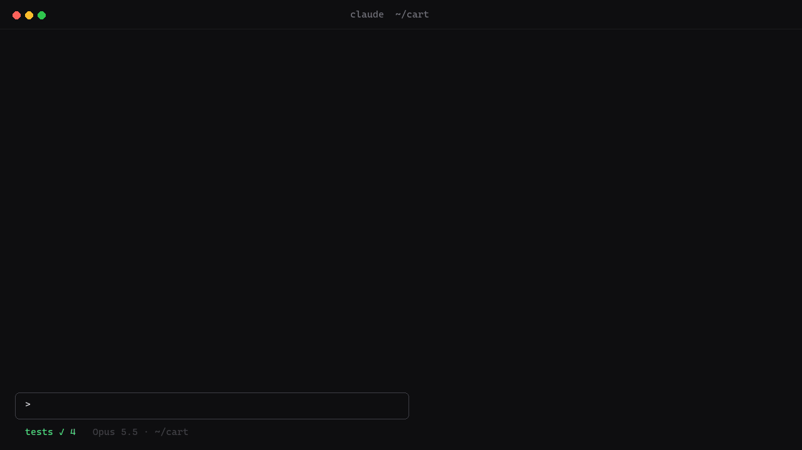

<h1 align="center">
  <picture>
    <source media="(prefers-color-scheme: light)" srcset="docs/brand/banner-light.svg">
    
  </picture>
</h1>

<p align="center">
  <a href="https://github.com/hellosverre/redgreen/releases/latest"></a>
  <a href="LICENSE"></a>
  
</p>

<p align="center">When Claude runs your tests, every failure lands in a pane beside the chat:<br>the failing tests by name, the one you pick in full, and the runs before it.</p>



## Install

Needs Claude Code **2.1.293** or later, in a terminal or the desktop app's Code tab. Run both inside Claude Code:

```
/plugin marketplace add hellosverre/redgreen
```

```
/plugin install redgreen@redgreen
```

Restart Claude Code. Nothing to set up: the next time Claude runs your tests, redgreen reads them.

## Update

```bash
claude plugin marketplace update redgreen
```

```bash
claude plugin update redgreen@redgreen
```

## Uninstall

```bash
claude plugin uninstall redgreen@redgreen
```

## Use

| | What it does |
|---|---|
| A failing run | Opens the **Tests** pane on its own and sets the status line to `tests ✗ 3/4` |
| A green run | Updates the status line to `tests ✓ 4`; the pane stays shut |
| `/tests` | Opens the pane on the latest run |
| `/tests clear` | Empties the history and clears the status line |
| A failure's name | Shows its detail: the assertion, the diff, the code frame |
| `p` · `n` · `l` | Older run, newer run, latest run |
| `k` · `j` | Previous and next failure, when the list is longer than the pane |

The history keeps the session's last 50 runs, as red and green blocks you can step through.

## Runners

| Runner | Read from | Counts |
|---|---|---|
| vitest | `vitest`, `vitest run` | tests, plus files that failed to load |
| jest | `jest` | tests, `›` paths as `>` |
| pytest | `pytest`, `python -m pytest` | tests, class tests as `Class > test` |
| cargo | `cargo test`, `cargo +toolchain test` | tests, ignored as skipped |
| go | `go test` | packages, or tests and subtests with `-v` |
| bun | `bun test` | tests |
| deno | `deno test` | tests |

Scripts that wrap a runner work too: `npm test`, `pnpm test`, `yarn test`, `turbo run test`,
`nx test`, `make test`, `tox`, `nox`. redgreen finds the runner from the output, after stripping
colour codes and the `pkg:test:` prefix turbo and `pnpm -r` put on every line.

## How it works

redgreen watches Claude's **Bash** and **PowerShell** tool calls. When a command runs tests, it parses
the output Claude already got back into counts and failures, and keeps the run in the session. When
Claude Code cut a long output short, redgreen reads the full copy Claude Code saved to disk. It only
reads: it never changes a command, its output or what the model sees, and if parsing throws, Claude's
call keeps its result untouched. No network, no files written, no settings. Check it yourself with
`claude plugin validate .`.

The demo above is drawn by [`scripts/demo.py`](scripts/demo.py) from the parser's own reading of
the vitest fixture, laid out row for row like the pane. It is not a screen recording.

## Develop

```bash
git clone https://github.com/hellosverre/redgreen && cd redgreen
```

```bash
claude --plugin-dir .
```

Saving a file reloads the mod in the running session. Tests: `claude plugin test .`. A new runner is
a parser in `hooks/parse.ts`, a fixture of its real output in `tests/fixtures.ts` and a test in
`tests/parse.test.ts`.

## More mods

- [skins](https://github.com/hellosverre/claude-skins): tool rows with icons, diff and chart cards, fifteen themes
- [smart-compact](https://github.com/hellosverre/smart-compact): compacts after a commit, green tests, before the prompt cache expires, or when Claude asks
- [mod-store](https://github.com/hellosverre/mod-store): browse, search and install 2,700 mods from a pane

## License

MIT
